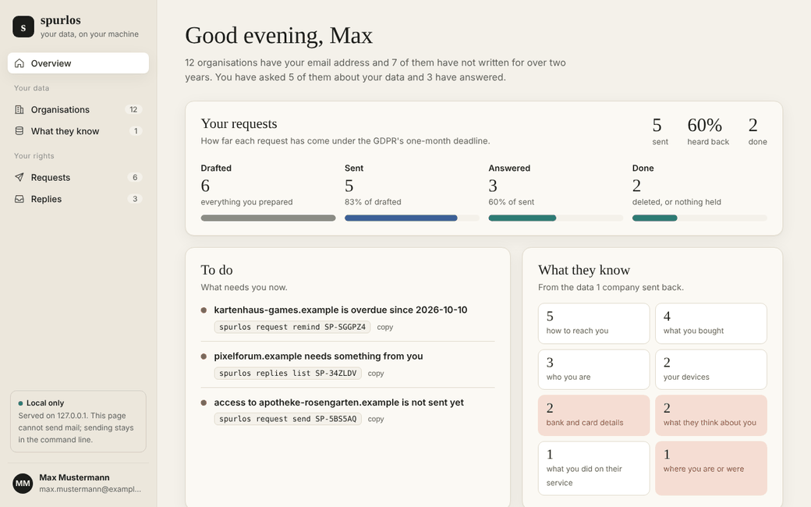
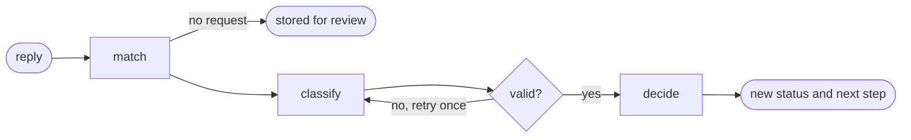
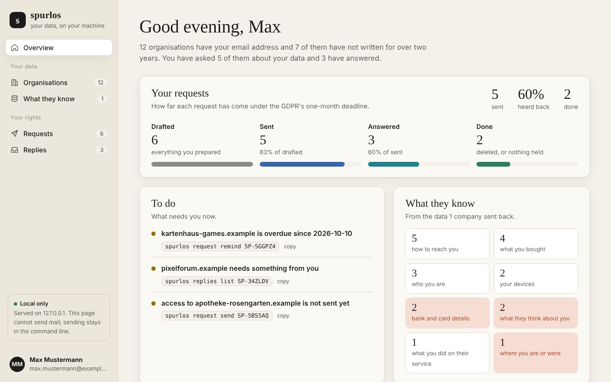
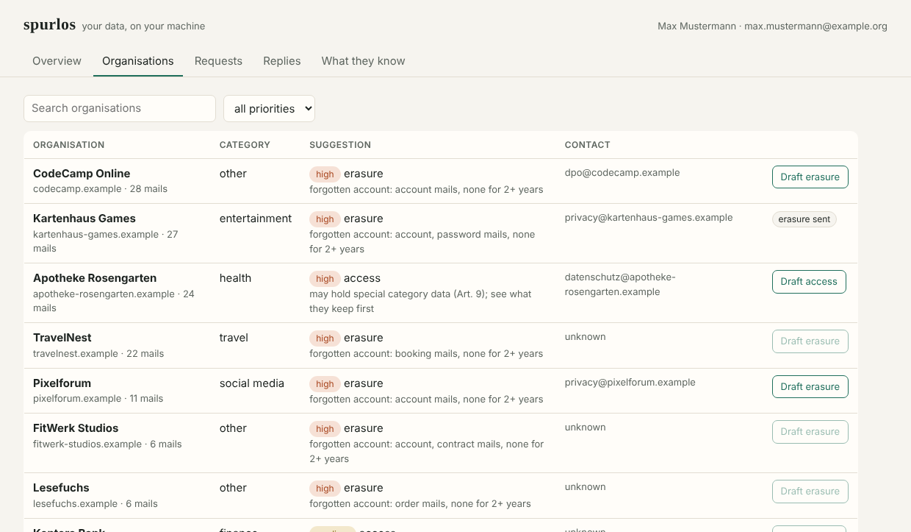
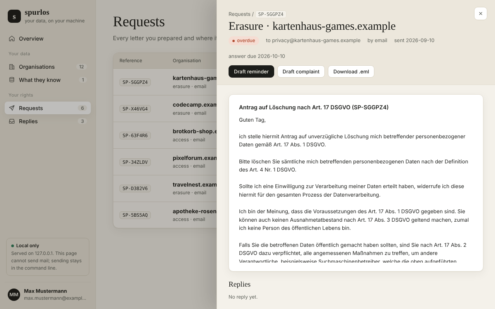
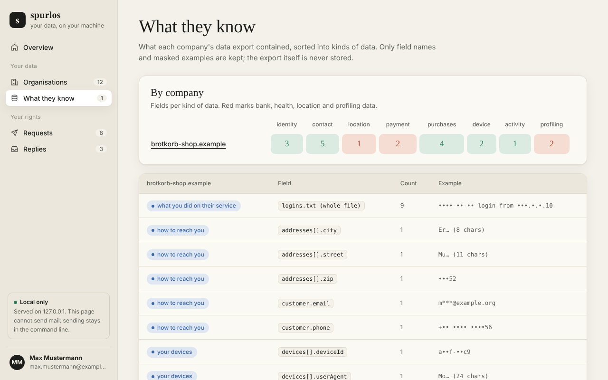

# spurlos

*German for "without a trace".*

Every company that has ever sent you an email has your address, and usually much more.
spurlos finds them, asks them what they store about you and gets it deleted under the GDPR.
It runs on your own machine: no account, no server, no third party that you have to hand
your data to so that it can be deleted.

[](https://github.com/ihkuzu/spurlos/actions/workflows/ci.yml)
[](https://github.com/ihkuzu/spurlos/releases)

> Version 0.1. Everything below works and is tested on Linux and Windows. It has not been used
> on many real mailboxes yet, so expect rough edges and please open an issue when you hit one.

## Demo



The demo uses made-up companies and a made-up person, so you can run the same thing yourself
without touching your own mail: `spurlos demo`. The reply agent runs with its keyword rules
here; a local model gives better labels but takes a few seconds per reply.

## What it does today

```
$ spurlos demo
wrote 215 demo messages to data/demo.mbox, 215 imported into ~/.spurlos/vault.db

$ spurlos census
12 organisations have your email address (from 215 messages, 10 from private mailboxes left out).
7 of them have not written for over two years: likely forgotten accounts.

organisation                 domain                         mails  first       last        newsletter
CodeCamp Online              codecamp.example                  28  2017-11-12  2020-10-13  75%
Kartenhaus Games             kartenhaus-games.example          27  2014-10-25  2016-09-29  0%
Apotheke Rosengarten         apotheke-rosengarten.example      24  2024-11-05  2026-09-27  0%
...

$ spurlos triage
12 organisations, 5 with a known privacy contact.
priority: 7 high, 5 medium, 0 low

[high  ] Kartenhaus Games (kartenhaus-games.example) - entertainment
         erasure: forgotten account: account, password mails, none for 2+ years
         contact: privacy@kartenhaus-games.example
[high  ] Apotheke Rosengarten (apotheke-rosengarten.example) - health
         access: may hold special category data (Art. 9); see what they keep first
         contact: datenschutz@apotheke-rosengarten.example
...
```

The demo mailbox is made up and uses `.example` domains, so nothing in it can reach a real
company. Run it on your own mail to see your real numbers.

## How it decides

For every organisation spurlos looks at three things:

1. **Who they are.** The sender domain is looked up in the open
   [Datenanfragen.de](https://www.datarequests.org) database: about 3,000 organisations with
   their privacy contact, category and preferred way of contact, released under CC0. A copy
   ships with spurlos, so lookups work offline. `mail.news.zalando.de` finds Zalando SE and
   `datenschutz@zalando.de`.
2. **What they likely hold.** Subject lines show whether there is more than an email address:
   welcome and verification mails (an account), orders and invoices (name, address, payment),
   password resets, contracts and bookings. Patterns cover German, English and Turkish.
3. **What kind of organisation it is.** Taken from the database first, then from simple name
   rules (Apotheke, Bank, Versicherung, ...). Only what is still unknown goes to a local model
   with `--llm`, and its answer has to be one of a fixed list of categories.

From that it suggests one action:

| situation | action | priority |
|---|---|---|
| address dealers, ad networks, credit agencies | access + objection (Art. 15, 21) | high |
| health, religion, politics (Art. 9 data) | access first | high |
| account with no mail for two years | erasure (Art. 17) | high |
| no mail for two years | erasure | medium |
| active account, contract, bank, insurer | access | medium |
| newsletter only | unsubscribe link | low |

```
spurlos triage                      # rules only, no model
spurlos triage --llm                # ask a local Ollama model for unknown categories
spurlos triage --llm --model qwen2.5:7b
spurlos registry show dhl.de        # all matching records
spurlos contact shop.de --email datenschutz@shop.de   # add a contact the database lacks
spurlos registry update             # fetch the latest database from GitHub
```

The model runs through [Ollama](https://ollama.com) on your machine; no subject line leaves
your computer. Categories are an easy task and a 3B model is enough for them; for reading
replies a 7B model is clearly better, see [How well does it label?](#how-well-does-it-label).

## Sending requests

```
spurlos profile --name "Max Mustermann" --email max@gmail.com
spurlos request new zalando.de --kind access          # one draft
spurlos request batch --priority high                 # drafts for every high item in triage
spurlos request send SP-7K2Q9M                        # shows the mail, asks, then sends
spurlos request list
```

```
SP-XQMLU3  erasure   kartenhaus-games.example       email   draft
SP-KN3KEZ  erasure   codecamp.example               email   sent 2026-09-01, OVERDUE by 21 days
SP-F874UW  access    apotheke-rosengarten.example   email   draft
```

- **The letters are fixed legal text, not generated.** They are the access (Art. 15), erasure
  (Art. 17) and objection (Art. 21) templates of Datenanfragen.de, in German or English
  depending on the company. No model writes or changes them.
- **Only the data needed to find you.** Name, email and a reference number. Your postal
  address is added only for companies whose record says they need it.
- **Nothing is sent without you.** `send` prints the full mail and waits for you to type
  `yes`. It goes out from your own address over your provider's SMTP, with a copy to yourself
  as proof of the date. The password is asked for each time and not stored.
- **Or send it yourself.** `request export ID --out request.eml` writes a draft your mail
  program opens; afterwards `request mark-sent ID` starts the clock.
- **Deadlines.** Companies have one month to answer (Art. 12(3)); `request list` counts the
  days and marks overdue requests. Each request carries a reference like `SP-7K2Q9M` in the
  subject, so replies can be matched to it later.
- **Web forms and letters** are never emailed. spurlos shows where to send the text instead.
- **Example addresses are blocked.** Mail to `.example`, `.test` and similar domains never
  leaves the machine, so the demo cannot reach anyone.

## Reading the answers

```
spurlos replies import ~/Downloads/inbox.mbox     # or a folder of .eml files
spurlos replies fetch --host imap.gmail.com --user max@gmail.com --llm
spurlos replies list
spurlos replies relabel 3f9a1c2e data_provided     # the agent was wrong: you decide
```

```
SP-5WEJ9B codecamp.example: id_required (rules)
    next: they ask for more information; send only that

SP-5WEJ9B  erasure   codecamp.example               email   waiting_on_you
```

With `--llm` the model also writes a one-line summary and what exactly they ask for.

The reply agent is a small [LangGraph](https://github.com/langchain-ai/langgraph) graph:



- **match** finds the request by thread (`In-Reply-To`), by the `SP-` reference or, if only
  one request is open with that company, by sender domain. No model.
- **classify** gives one of eight labels: `confirmed`, `data_provided`, `no_data`,
  `id_required`, `extension`, `refused`, `acknowledged`, `auto_reply`. Mails marked
  `Auto-Submitted` skip the model. Without `--llm`, keyword rules decide.
- **check** rejects any answer that is not one of the eight labels and asks the model once
  more, telling it what was wrong. A second bad answer, or a model that is not running, falls
  back to the rules.
- **decide** is a fixed table, not a model: `confirmed` closes the request, `extension` moves
  the deadline by two months (Art. 12(3)), `refused` marks it for a complaint, `id_required`
  tells you what they want. The agent never sends anything.

**What is read.** spurlos downloads full messages only for possible replies: mails with an
`SP-` reference in the subject and mails from companies you have written to, since the day
you first wrote. Everything else stays headers-only. The text of a reply is treated as data;
a mail that says "ignore your instructions" can at most get a wrong label, which you can
correct with `relabel`.

### How well does it label?

`spurlos eval-replies` runs the agent on 40 example answers in German and English, five per
label, and `--llm` adds a local model:

| labeller | correct | time per reply | weakest labels |
|---|---|---|---|
| keyword rules | 31 / 40 | 0 s | `no_data` 2/5, `id_required` 3/5 |
| llama3.2:3b | 34 / 40 | 2.6 s | `confirmed` 2/5 (read as `refused`), `id_required` 3/5 |
| qwen2.5:7b | 39 / 40 | 4.4 s | `acknowledged` 4/5 (one read as `confirmed`) |

Measured on an RTX 2060 with 6 GB through Ollama, temperature 0, no retries or fallbacks
needed in either run. The 3B model beats the rules by three replies but mixes up "deleted,
except invoices we must keep" with a refusal; the 7B model gets all but one right and is the
recommended default when it fits on the card.

Two things to keep in mind. The examples are made up, written for this project by the same
person who wrote the rules, so the rules may look better here than on real mail. And 40
replies are few: one reply more or less is 2.5 points, so read the numbers as a ranking, not
a precise score.

## When they do not answer

```
spurlos todo
SP-6FTG2B  apotheke-rosengarten.example refused
           spurlos request complain SP-6FTG2B
SP-TSZZJT  codecamp.example is overdue since 2026-10-10
           spurlos request remind SP-TSZZJT
SP-TXCAEL  erasure to pixelforum.example is not sent yet
           spurlos request send SP-TXCAEL
```

- **Reminder.** `request remind ID` drafts a reminder once the month is over. It names the
  date of your request and its reference, gives two weeks and quotes the original request.
- **Complaint.** `request complain ID` drafts a complaint under Art. 77 GDPR for a request that
  was refused or ignored. Art. 77 lets you complain where you live, so spurlos picks the
  authority of your federal state (`spurlos profile --state BY` gives the Bavarian BayLDA)
  or of your country. The facts are filled in: what you asked for, when, the deadline, the
  reminder, their reason for refusing and, with `--why`, yours.
- Both are drafts like any other request: you read them, then send them yourself.
- An answer to a reminder or complaint updates the original request.

## A local web page

```
spurlos ui
```

opens a page in your browser with the overview, the organisations and their suggested action,
your requests with their deadlines and every reply with the agent's label, which you can
correct there. You can draft requests, reminders and complaints, download a request as
`.eml` and mark it as sent.

- It listens on `127.0.0.1` only and every call needs a token that is created when it starts.
- It loads nothing from the internet: no fonts, no scripts, no tracking. A strict
  Content-Security-Policy enforces that.
- It cannot send mail. Sending stays in the command line, where you see the full message
  and type `yes`.
- Text from companies is shown as text, never as HTML.

| Overview | Organisations |
|---|---|
|  |  |
| **One request** | **What they know** |
|  |  |

## What they know about you

When a company answers an access request, it sends you your data: a zip with JSON and CSV
files, a PDF letter or a plain text mail. spurlos reads it and notes what kinds of data it
contains.

```
$ spurlos export import brotkorb-shop.example data/demo-export.zip
brotkorb-shop.example: 3 files read, 20 kinds of fields

  bank and card details (payment)
    payment.iban                                1x  e.g. DE•• •••• •••• •••• •••• 00
  what you bought (purchases)
    product                                    14x  e.g. Ro… (10 chars)
  where you are or were (location)
    ip address                                  9x  e.g. •••.•.•.10
  ...

$ spurlos map
organisation                   payment purchases  location   contact  identity    device profiling  activity
brotkorb-shop.example                2         4         1         5         3         2         2         1

$ spurlos map --category location
who holds where you are or were:
  brotkorb-shop.example        ip address
```

- Field names are sorted into eleven kinds of data (who you are, contact, location, payment,
  purchases, devices, activity, messages, profiling, health, other) by the words in them,
  in German and English. Values that look like an IBAN, an email address, a phone number
  or an IP address are found in text and PDFs too.
- If you sent that company an access request, it is marked done.
- Only the field name, how often it appears and a masked example go into the vault. The
  export itself is read in memory and never unpacked or copied.
- Zips are checked before reading: at most 5,000 files, 50 MB per file and 500 MB in total,
  and a file that is bigger than its zip header says is refused.
- PDFs need `pip install "spurlos[pdf]"`. Scanned PDFs without a text layer are not read.

The sorting goes by words, so it gets things wrong: a field called `title` can be a film you
watched or your salutation. Use the map as a starting point and look into the export for
anything that matters.

## Ask your AI assistant (MCP)

```
pip install "spurlos[mcp]"
```

`spurlos mcp` starts an [MCP](https://modelcontextprotocol.io) server over stdio, so an MCP
client such as a desktop chat app, an IDE assistant or a local agent can answer questions like "which forgotten
accounts should I delete first?" or "who has my bank details?" from your vault. Add it to
the client's configuration:

```json
{
  "mcpServers": {
    "spurlos": { "command": "spurlos", "args": ["mcp"] }
  }
}
```

It has seven tools: `overview`, `list_organisations`, `organisation`, `list_requests`,
`get_request`, `todo` and `who_holds`.

- The vault is opened read-only (SQLite `mode=ro` and `query_only`); a test checks that the
  file is byte for byte the same after every tool has run.
- It cannot send mail or change anything. To act, the assistant tells you which `spurlos`
  command to run.
- Mail subjects and the text of replies are not available through it. Organisation names,
  request statuses, the agent's one-line summaries and the masked examples are.
- What the tools return goes to whatever model your client uses. With a cloud model, that
  information leaves your machine. With a local model, it does not.

## Privacy by design

- **Headers only.** Over IMAP, spurlos asks the server for five header fields
  (`From`, `Date`, `Subject`, `Message-ID`, `List-Unsubscribe`) with `BODY.PEEK`, so no
  message body is downloaded and nothing is marked as read. The mailbox is opened read-only.
  A test checks exactly this.
- **Local only.** Everything goes into one SQLite file, `~/.spurlos/vault.db`
  (or `$SPURLOS_HOME`), readable only by you. Nothing is uploaded anywhere.
- **No data out.** The only network calls are to your own mail server (reading headers and,
  when you confirm, sending your requests), to a model on your own machine and, if you ask
  for it, to GitHub to download the public contact database.
- **Your own data only.** spurlos works on your own mailbox. It does not search for other
  people and will not send requests in anyone else's name.

## Install

```
pip install git+https://github.com/ihkuzu/spurlos.git
```

Python 3.10 or newer. Works on Linux, macOS and Windows. For the MCP server and PDF exports:
`pip install "spurlos[mcp,pdf] @ git+https://github.com/ihkuzu/spurlos.git"`.

**With Docker.** The vault lives in a folder you mount, so nothing is lost when the container
goes away:

```
docker build -t spurlos https://github.com/ihkuzu/spurlos.git
docker run --rm -v "$HOME/.spurlos:/data" spurlos demo --path /data/demo.mbox
docker run --rm -v "$HOME/.spurlos:/data" spurlos census
docker run --rm -v "$HOME/.spurlos:/data" -p 127.0.0.1:8044:8044 spurlos ui --host 0.0.0.0 --no-browser
```

Publish the web page to `127.0.0.1` only, as above. To use a local model from the container,
add `-e OLLAMA_HOST=http://host.docker.internal:11434` (on Linux also
`--add-host=host.docker.internal:host-gateway`).

## Use it on your mail

**From a file.** Export your mail as mbox (Google Takeout, Thunderbird with the
ImportExportTools add-on) or as a folder of `.eml` files:

```
spurlos import mbox ~/Downloads/All-mail.mbox
spurlos import eml ~/mail-export/
```

**Over IMAP.** Most providers need an app password for this (Gmail: Google account →
Security → App passwords). The password is read from `SPURLOS_IMAP_PASSWORD` or asked for
and is never stored.

```
spurlos import imap --host imap.gmail.com --user you@gmail.com --list-folders
spurlos import imap --host imap.gmail.com --user you@gmail.com --folder "[Gmail]/All Mail"
spurlos import imap --host imap.gmx.net --user you@gmx.de --all-folders --since 2015-01-01
```

Then:

```
spurlos census              # top 25
spurlos census --limit 0    # all
spurlos census --json       # for other tools
spurlos me other@address.de # leave out more of your own addresses
```

Mails from private mailboxes (gmail.com, web.de, gmx.de, ...) are counted as people and
left out of the list.

## Roadmap

1. Read the mailbox and list the organisations (done)
2. Privacy contacts from the open database, signals for real accounts and categories from
   rules or a local model, plus a suggested action per organisation (done)
3. GDPR requests from fixed legal templates in German and English, sent from your own address
   only after you confirm, with the one-month deadline tracked (done)
4. A reply agent that matches answers to requests, labels them and sets the next step, with
   an eval of 40 example answers (done)
5. Reminders after the one-month deadline, a complaint draft for the right data protection
   authority and a local web page (done)
6. Reading the data exports companies send back, so you can see who knows what about you,
   and a read-only MCP server for AI assistants (done)
7. Demo, Docker and a first release, 0.1 (done)

Next: real replies from real companies to measure the agent on, more templates (portability,
correction) and a guided first run for people who never used a terminal.

## Not legal advice

spurlos helps you use rights the GDPR gives you. It is not a lawyer, and the letters it
prepares are templates you check before you send them.

## Credits

Privacy contacts, supervisory authorities and request templates come from
[datenanfragen/data](https://github.com/datenanfragen/data) (CC0 1.0). Missing or wrong
records are best fixed there, so every tool that uses the database gets the fix.

## License

MIT
